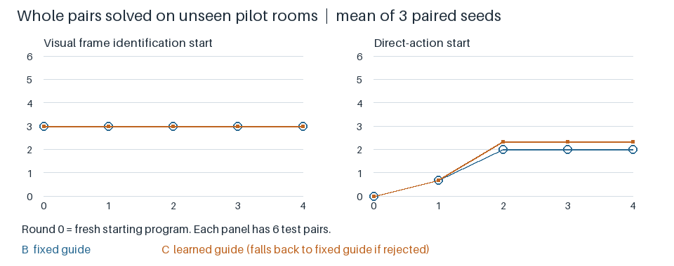

# Can an AI learn to debug a robot’s visual memory?

A robot saw a laptop, turned away, and walked across the room. To find it again, which old photo should it look at, and should it turn left or right **from where it stands now**?

We gave a coding model a working navigation program and a budget of 12 attempts to improve it. Across five runs, the model that revised its code using examples of its mistakes averaged **58.8 correct turns out of 120** in held-out rooms. Independent rewrites averaged **59.6**, and the starting program got **61**. We could trace individual fixes through several versions, but they did not add up to a reliable improvement on new routes.

This repository contains the main experiment and a smaller follow-up for the [CUHK-Shenzhen NLP final project, Track A5](https://nlp-course-cuhksz.github.io/final-project.html).

## Reproduce the numbers

From the repository root, run these commands with Python 3.9 or newer. Both use the standard library and saved decisions. No model download or GPU is required.

```sh
python3 experiment3/src/analyze_results.py
python3 experiment4/audit.py
```

The first command checks candidate source hashes, reconstructs the main table and traces fixes back to their parent versions. The second checks image hashes, the four room splits, and the program selected at each attempt in the follow-up. Read the resulting [main table](experiment3/results/main.csv) and [follow-up curves](experiment4/transfer_curve.csv). These commands reproduce the analysis of completed runs. Generating new candidates requires the model weights and a Linux GPU environment.

## What changed across the experiments?

| Study | What the AI could change | What happened |
| --- | --- | --- |
| 1. Pick the photos | Choose a rule for selecting two old photos. | Independent attempts averaged 61.3% on unseen rooms. Revising from feedback averaged 60.7%. [Scores](earlier-studies/photo-selection.csv) |
| 2. Pick the decision rule | Search 25 ways to use photos and movement history. | Increasing the budget from six to twelve attempts helped both groups. They ended at 69.67% and 69.50%. [Budget curve](earlier-studies/rule-search.csv) |
| 3. Write the program | Rewrite a Python controller or revise the best previous version. | All three groups improved on development routes. None beat the starting program on average in held-out rooms. |
| 4. Write a debugging guide | Carry a short learned instruction into a fresh program after taking away the old code. | One of three seeds produced a guide that helped one new starting program. The pilot stopped below its two-seed expansion threshold. |

The tasks and scoring rules changed between studies. Compare methods **within a study**.

## The main comparison

Each group used the same frozen coding model, five paired seeds and twelve attempts per seed. Each candidate could consult the frozen visual tools at most twice per question. We selected programs on development data, locked the checkpoints, and scored each distinct frozen program once on the held-out set.

| What the coding model received | Development correct / 120 | Held-out correct / 120 |
| --- | ---: | ---: |
| Starting program | 55 | 61 |
| A. Start over each time | 61.4 | 59.6 |
| B. Inherit the best code and previous scores | 60.4 | 59.4 |
| C. Also see examples fixed or broken by the last edit | 57.0 | 58.8 |

One edit told the robot to trust the vision model’s turn prediction when it could not locate the object in a photo. That rescued a microwave question and broke a stool question. You can inspect [the recorded edit and its parent](experiment3/formal/runs/B47/r07.json), [the replay images for both cases](experiment3/results/B47_replay.jpg), and [what happened when individual edits were removed](experiment3/results/factorial.csv). Both cases came from the same room. A limitation of this test was that both objects in each held-out target pair appeared in the same old photograph.

## What did the guide learn?

The follow-up introduced pairs where changing the target required changing the photo. Other pairs changed the endpoint or covered part of one old image. Eight pilot rooms were divided among learning, guide selection, adaptation and final evaluation. The last two rooms contained **six pairs**. One point required the correct photo and turn on both questions in a pair.

One [retained guide](experiment4/runs_v2/47/guide_lock.json) advised checking that a visual tool had returned a point before using its coordinates. With that sentence, one fresh program improved from **2/6 to 3/6** pairs. It now turned right for a laptop and left for a plant at the same endpoint. The other starting program stayed at 3/6, and the other two seeds kept the original guide. Neither group solved a complete endpoint-change pair. The small sample and single successful seed limit what we can claim about transfer.



## Where to look

- [All 180 main-study attempts](experiment3/formal/runs), [frozen checkpoints](experiment3/formal/candidate_lock.json), and [per-program held-out decisions](experiment3/formal/hidden_results).
- [Evaluation inputs and frozen splits](experiment3/dataset), including cached public visual readings for decision replay. The published splits were held out during the original search and are now available for inspection.
- [Follow-up split](experiment4/dataset/pilot/split.json), [revised pilot runs](experiment4/runs_v2), [sealed pilot scores](experiment4/pilot_results_v2), and [both pilot versions’ costs](experiment4/budget.csv).
- The original setup used AI2-THOR, Qwen3-4B-Instruct-2507 for coding, Qwen2.5-VL-7B-Instruct and CLIP for visual readings, and two RTX 5090 cards. See the [inference environment](pilot/policyenv.freeze), [simulator environment](pilot/simenv.freeze), and [original run manifest with model hashes](experiment3/formal/prerun_lock.json). Machine-specific model paths have been replaced by portable names in this release.
